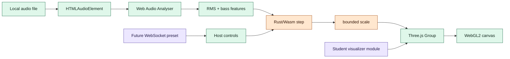

# Rust/Wasm Music Visualizer

This is the canonical lesson index for the six-lesson studio. The runnable application is maintained separately in the [Rust/Wasm Music Visualizer experiment repository](https://github.com/ruvebal/rust-wasm-music-visualizer). Start with the [live X1 experiment](https://ruvebal.github.io/rust-wasm-music-visualizer/), then clone the repository when you need to edit code.

| Lesson | Question | Product increment |
| --- | --- | --- |
| [L1 · Rust at the browser boundary](l1-rust-browser-boundary/) | What should Rust own? | A bounded Rust/Wasm mapping call |
| [L2 · Listening before drawing](l2-audio-features/) | What are we measuring? | RMS/bass features and silence |
| [L3 · Giving sound a body](l3-gpu-3d/) | How does sound become space? | An original depth-tested scene |
| [L4 · Animation systems and clocks](l4-clocks-controls/) | What is local time? | Pause, seek, loop and controls |
| [L5 · Sending intention over a network](l5-websocket-control/) | What should cross a network? | A bounded remote preset/control |
| [L6 · Proving and exhibiting the instrument](l6-proof-exhibition/) | What makes the work defensible? | Tests, benchmark and defence |

L1–L4 are runnable against the current X1 baseline. L5 becomes runnable when the X3 relay is tagged; L6 is the release and exhibition gate.

## Read the stack as one instrument



The ownership rule is the key: the browser decodes audio and draws pixels; Rust transforms normalized features; students replace or extend the mapping and scene. WebSockets, Rive and a formal plugin lifecycle are later layers, not hidden requirements in the X1 baseline.

| Layer | Current responsibility | Where to look |
| --- | --- | --- |
| Browser transport | Play, pause, seek, loop and local file selection | `src/main.js:99-158` |
| Web Audio | Read time-domain and frequency-domain arrays | `src/main.js:86-97` |
| Rust/Wasm | Smooth, clamp and map features to scale | `rust/src/lib.rs:23-31` |
| Three.js/GPU | Create meshes, light the scene and render frames | `src/main.js:32-62`, `176-191` |
| Student seam | Load a same-origin module with `createVisualizer()` | `src/main.js:163-174` |
| Future network | Send bounded presets or parameter intent | L5, after X3 relay release |

## If Rust is new to you

You do not need to know Rust before Studio 1. We will learn only the pieces this instrument needs:

1. a function takes values and returns a value;
2. a `struct` groups related data (we use one later for plugin state);
3. a type such as `f32` tells us this is a 32-bit floating-point number;
4. `cargo test` runs checks, and `cargo build --target wasm32-unknown-unknown` produces a browser-loadable module;
5. the browser calls the exported function; Rust does not replace the browser’s audio or rendering APIs.

Every lesson follows the same rhythm: predict → run → inspect → change one thing → explain. You may ask an assistant for a syntax hint, but your submission must include the prediction, the test result and the reason for the change.

## Grounding note

The sequence uses backward design: begin with the evidence students must produce, then build the activities that make that evidence possible (Wiggins and McTighe 2011, 8–9). The prediction-and-verification rhythm is a course design choice informed by research on cognitive scaffolding in AI-assisted programming education (Liu, Fan, and Pan 2026, 17); it is not presented as a measured effect of this exact studio.

### References

- Liu, Dandan, Guangrui Fan, and Lihu Pan. 2026. “Tool, Tutor, or Crutch?: A Grounded Theory of Cognitive Scaffolding and Offloading in AI-Assisted Programming Education.” *International Journal of STEM Education* 13, article 10. https://doi.org/10.1186/s40594-025-00592-w.
- Wiggins, Grant, and Jay McTighe. 2011. *The Understanding by Design Guide to Creating High-Quality Units*. Alexandria, VA: ASCD.

## Shared setup

```sh
git clone https://github.com/ruvebal/rust-wasm-music-visualizer.git
cd rust-wasm-music-visualizer/web-foundations/private/x1-vertical-slice
npm install
npm test
npm run dev -- --host 127.0.0.1
```

Open the Vite URL, not the HTML file directly. The browser needs HTTP to fetch the Wasm module.


<!-- curriculum-internal:
[VERIFIED] Backward-design frame: Ahmes anchor `d2d094ae-c2d9-56a6-ace9-5d37e8a126a5`, local Wiggins/McTighe source, printed pp. 8–9, evaluator_safe=yes. Transfer boundary: supports sequencing from desired evidence; it does not prove this exact six-lesson schedule.
[VERIFIED] AI-assisted programming pedagogy frame: Ahmes anchor `5ef651db-df6d-5906-b714-1672f8810a22`, Liu/Fan/Pan source, printed p. 17, evaluator_safe=yes. Transfer boundary: supports prediction, verification and individual explanation as design choices; it is not an efficacy claim about this studio.
-->

